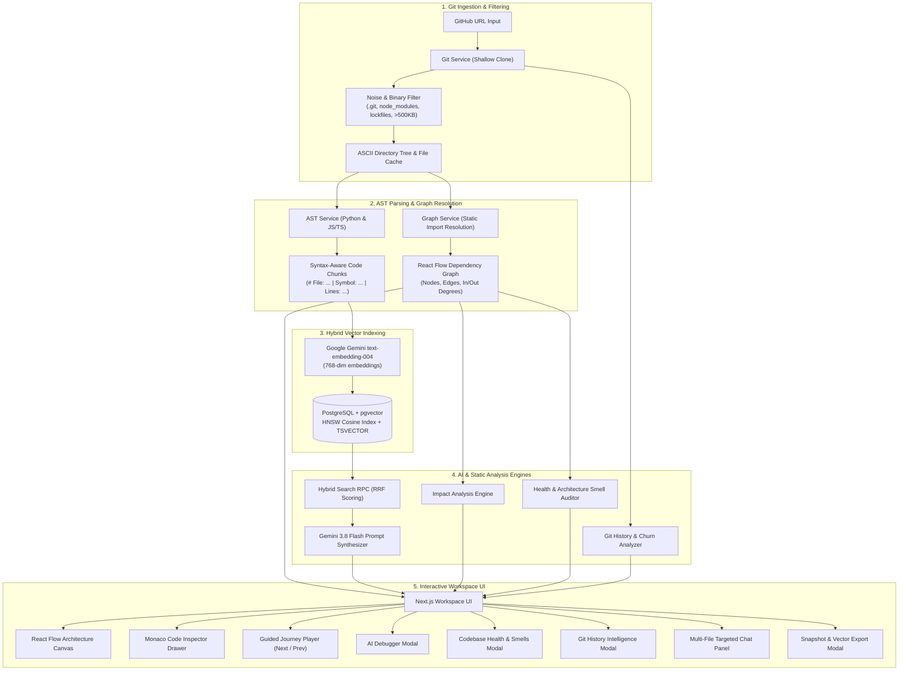

# 🧭 CodeAtlas — AI Codebase Explainer & Interactive Architecture Intelligence Platform

<div align="center">


<p align="center">
  <strong>Turn any public GitHub repository into a visual architecture map, syntax-aware hybrid vector index, interactive execution pathfinder, impact analyzer, codebase health auditor, git intelligence timeline, and streaming RAG copilot.</strong>
</p>

</div>

---

## 🌟 Overview

**CodeAtlas** is an intelligent developer onboarding, static analysis, and codebase comprehension platform. Given any public GitHub repository URL, CodeAtlas shallow-clones the repo, filters out binaries and noise, parses Abstract Syntax Trees (AST) to construct an interactive dependency graph, indexes syntax-aware code chunks into a hybrid vector database (`pgvector` + Full-Text Search via Reciprocal Rank Fusion), and provides a comprehensive suite of developer intelligence tools:

1. **Interactive Architecture Map**: React Flow canvas with Dagre auto-layout (LR/TB), directory badges, and degree centrality metrics.
2. **AI Architecture Explanation Mode**: Switch between *Beginner*, *Intermediate*, and *Expert* modes with one click to understand system entry points, data flow, key modules, and Day-1 onboarding roadmaps.
3. **"Journey Through the Codebase" Guided Tours**: Select workflows (e.g., *"How does authentication work?"*) to step through an interactive execution path (UI → Route → Service → Database) with synchronized canvas panning and Monaco line highlights.
4. **AI Debugger & Error Explorer**: Paste runtime error traces or TypeErrors to locate suspect lines, causal execution paths, and copy-pasteable code diff fixes.
5. **"What Happens If I Change This?" Impact Analysis**: Compute upstream and downstream blast radius, transitive dependents, and highlight affected nodes directly on the architecture graph.
6. **Codebase Health & Architecture Smell Detection**: Audit repository health (0–100), identify circular dependencies (with exact cycle paths), God files, oversized blobs, dead modules, and high coupling.
7. **Git History Intelligence & Code Evolution**: Discover top contributors, commit churn rates, temporal co-change coupling, and an interactive chronological Code Evolution timeline.
8. **Chat With Selected Code**: Pin multiple files or nodes to inject exact AST chunks into chat for targeted multi-file comparisons and data flow tracing.
9. **Architecture Snapshots & Export Engine**: Export high-resolution vector SVG and PNG diagrams, download full Markdown architecture documentation reports, and copy GitHub-ready Mermaid diagrams.
10. **Automated Onboarding Documentation**: Synthesize a comprehensive 6-section `ONBOARDING.md` with live dark-mode Mermaid diagrams and clickable code citations.
11. **Linear-Grade Executive Overview & Workspace Navigation**: Collapsible sidebar navigation categorizing workflows into *Overview*, *Architecture*, *Intelligence*, and *Documentation* with real-time repository health radars.
12. **Global Command Palette (`Ctrl+K` / `Cmd+K`)**: Raycast-style instant search launcher for rapid keyboard navigation across codebase files, intelligence tools, and workspace actions.

---

## 🏗️ Architecture & Data Flow



---

## ✨ Key Features & Capabilities

### 🧠 1. AI Architecture Explanation Mode (Beginner / Intermediate / Expert)
- Generates structured, high-signal architectural explanations tailored to developer experience levels:
  - **Beginner Mode**: Relatable real-world analogies, high-level purpose, visual metaphors, and a gentle 3-step Day-1 roadmap.
  - **Intermediate Mode**: Component communication protocols, request lifecycles, configuration setups, and practical extension points.
  - **Expert Mode**: Non-functional requirements, concurrency models, state isolation, latency trade-offs, and critical bottlenecks.
- Every explanation includes clickable `[file_path:start_line-end_line]` citations that instantly open the referenced code in Monaco.

### 🗺️ 2. "Journey Through the Codebase" Guided Interactive Tours
- Transforms static dependency graphs into live, step-by-step walkthroughs of real execution paths:
  - Select from pre-generated high-impact journeys (*"Authentication Flow"*, *"API Ingestion Pipeline"*, *"State Store Cycle"*) or enter any custom query.
  - Step through via **Next** and **Previous** controls.
  - Automatically pans and zooms the React Flow canvas to center each step's node, pulses connected edges, and slides open the Monaco editor focused on the exact executing lines.

### 🐛 3. AI Debugging & Error Explorer
- Paste any runtime error message or stack trace (e.g. `TypeError: Cannot read properties of undefined`, Python tracebacks, HTTP 500 responses).
- **Stack Trace Parser**: Automatically extracts file paths and line numbers from JavaScript, TypeScript, and Python traces.
- **Root Cause Analysis**: Correlates the error with the repository's AST chunks to identify suspect code statements with confidence ratings.
- **Actionable Fix Generator**: Generates copy-pasteable before-and-after code diffs with explanatory reasoning.

### 🔄 4. "What Happens If I Change This?" Impact Analysis Engine
- Select any file or function to evaluate the blast radius of proposed refactors or deletions:
  - **Direct Importers**: Immediate upstream dependencies.
  - **Transitive Ripple Effects**: Second- and third-order dependents across the entire repository.
  - **Criticality Score & Warnings**: Highlights core hub modules whose modification poses high regression risk.
  - **Highlight on Map**: One-click overlay that dims unrelated modules and highlights the entire affected blast radius on the architecture canvas.

### 📊 5. Codebase Health Dashboard & Architecture Smell Detection
- Comprehensive static analysis and graph audit for software architecture quality:
  - **Health Score (0–100)**: Quantitative health rating based on modularity, file sizing, circular coupling, and dead code ratios.
  - **Circular Dependencies (🔄)**: Tarjan's cycle detection identifies exact circular loops (e.g., `A.ts → B.ts → C.ts → A.ts`) with a button to highlight the cycle loop directly on the canvas.
  - **God Files (🐘)**: Detects over-connected hub files that import or are imported by an excessive percentage of the codebase.
  - **Oversized Blobs**: Flags modules exceeding maintainable line limits.
  - **Unused / Dead Modules**: Highlights zero in-degree root nodes that may represent obsolete code or missing entry points.
  - **High Coupling**: Detects tightly coupled file pairs needing abstraction.

### 🕰️ 6. Git History Intelligence & Code Evolution
- Connects Git commit history to the architectural map:
  - **Top Authors & Ownership**: Calculates commit volumes and percentages for each contributor to identify domain experts.
  - **Churn Rate & Activity Level**: Measures total commits, additions, and deletions with *High*, *Moderate*, or *Low* activity badges.
  - **Temporal Co-Change Coupling**: Uncovers hidden architectural dependencies by detecting files that consistently change together in shared commits.
  - **Chronological Code Evolution Timeline**: Visual commit log with author avatars, commit hashes, relative timestamps, and diff statistics.

### 💬 7. Chat With Selected Code (Multi-File Targeted Context)
- Pin multiple files directly from the Monaco code viewer, the architecture map, or the Git History modal.
- Active files appear as removable pills above the chat prompt.
- **Targeted Context Injection**: Bypasses generic global search to directly inject the pinned modules' full AST code chunks into the prompt.
- **Quick Action Prompts**: One-click prompt chips for *"Explain how these work together"*, *"Compare these implementations"*, and *"Trace data flow between them"*.

### 📸 8. Architecture Snapshots & Multi-Format Export Engine
- Export architecture visual assets and documentation with a single click:
  - **High-Resolution Vector SVG**: Scalable vector graphics export of the React Flow canvas with embedded styling.
  - **High-DPI PNG Canvas**: 2x pixel-density raster image export suitable for architecture reviews and slide decks.
  - **Full Markdown Report (`.md`)**: Comprehensive downloadable documentation package including summary, file breakdown, and Mermaid diagrams.
  - **GitHub-Ready Mermaid Syntax**: Instant clipboard copy of the dependency graph formatted for GitHub `README.md` and pull requests.

### ⚡ 9. Resilient Git Ingestion & AST Chunker
- Shallow clones (`--depth 1 --single-branch`) with a noise filter excluding `.git`, `node_modules`, `venv`, lockfiles, binary files, and files >500 KB.
- Syntax-aware chunking using Python AST and Tree-sitter for JavaScript and TypeScript.
- Prepend contextual headers to all chunks (`# File: ... | Symbol: ... | Lines: ...`) with line-accurate sliding-window fallbacks.

### 🔍 10. Hybrid Search Engine (Vector + Full-Text Search via RRF)
- Combines semantic vector similarity with PostgreSQL full-text search (`ts_rank`).
- Ranks results using **Reciprocal Rank Fusion (RRF)**:
  $$\text{RRF Score} = \frac{1}{60 + \text{rank}_{\text{vector}}} + \frac{1}{60 + \text{rank}_{\text{fts}}}$$
- **Graph Expansion**: Traverses the dependency graph from retrieved chunks to pull in neighboring module architecture context.

### ⚡ 11. Command Palette (`Ctrl+K` / `Cmd+K`) & Executive Overview Dashboard
- **Universal Command Palette**: Press `Ctrl+K` (or `Cmd+K` on macOS) anywhere in the application to access a Raycast-style launcher for fuzzy searching across all files, triggering AI intelligence modes, toggling layouts, and executing actions without leaving the keyboard.
- **Executive Overview Dashboard**: High-level repository cockpit featuring architecture health meters, top architectural hubs, language breakdown statistics, and one-click quick launchers into all exploration modes.
- **Linear-Grade Sidebar**: Collapsible navigation bar categorizing features into *Overview*, *Architecture Map*, *Intelligence Tools*, and *Documentation* with sleek spring animations and responsive collapse.

---

## 🛠️ Tech Stack

| Domain | Technology | Purpose |
| :--- | :--- | :--- |
| **Frontend Framework** | [Next.js 15](https://nextjs.org/) (App Router, React 19) | Modern SSR/CSR hybrid application |
| **Styling & Theme** | [Tailwind CSS](https://tailwindcss.com/) | Low-contrast dark theme (`zinc-950` palette) |
| **Graph Visualization** | [@xyflow/react](https://reactflow.dev/) + [Dagre](https://github.com/dagrejs/dagre) | Directed dependency graph with automated layout |
| **Code Editor** | [@monaco-editor/react](https://github.com/suren-atoyan/monaco-react) | Read-only syntax viewer with line decorations |
| **Markdown & Diagrams** | [react-markdown](https://github.com/remarkjs/react-markdown) + [mermaid](https://mermaid.js.org/) | Live rendering of onboarding docs and diagrams |
| **Backend Framework** | [FastAPI](https://fastapi.tiangolo.com/) + [Uvicorn](https://www.uvicorn.org/) | High-performance Python async REST & SSE API |
| **AST Parsing** | Python `ast` + [tree-sitter](https://tree-sitter.github.io/) | Syntax-aware chunking and import resolution |
| **Git Operations** | [GitPython](https://gitpython.readthedocs.io/) | Isolated shallow repository cloning & commit log mining |
| **Vector DB** | [PostgreSQL](https://www.postgresql.org/) + [`pgvector`](https://github.com/pgvector/pgvector) | 768-dimensional vector cosine indexing & FTS |
| **AI Models** | [Google Gemini 3.8 Flash](https://ai.google.dev/) + `text-embedding-004` | Chat reasoning, doc synthesis, and vector embeddings |

---

## 📂 Repository Structure

```
codeAtlas/
├── backend/                         # FastAPI 0.115+, Python 3.11+, Uvicorn
│   ├── app/
│   │   ├── config.py                # Settings & environment variables (BaseSettings)
│   │   ├── main.py                  # FastAPI entry point & REST/SSE route registry
│   │   ├── db/
│   │   │   └── supabase.py          # PostgreSQL/pgvector client + offline in-memory fallback
│   │   ├── models/
│   │   │   └── schemas.py           # Pydantic v2 validation models & URL normalizer
│   │   └── services/
│   │       ├── ast_service.py       # Syntax-aware AST chunker (Python, JS/TS, fallback)
│   │       ├── chat_service.py      # SSE streaming RAG Q&A & multi-file context engine
│   │       ├── debugger_service.py  # AI Error explorer & root-cause analyzer
│   │       ├── embedding_service.py # Google GenAI text-embedding-004 batch embedder
│   │       ├── explanation_service.py # Multi-level architecture explanation synthesizer
│   │       ├── git_history_service.py # Commit churn, top authors, co-change coupling & evolution
│   │       ├── git_service.py       # Shallow clone, noise filtering, directory tree
│   │       ├── graph_service.py     # Static import resolver & React Flow graph builder
│   │       ├── health_service.py    # Codebase health score, cycle detection & architecture smells
│   │       ├── impact_service.py    # Reverse-dependency blast radius analyzer
│   │       ├── journey_service.py   # Guided interactive execution pathfinder
│   │       └── onboarding_service.py# High-signal ONBOARDING.md synthesizer
│   ├── tests/                       # 37 automated unit and integration tests (100% passing)
│   ├── requirements.txt             # Python dependencies
│   └── schema.sql                   # Database schema with vector extension & RRF function
│
├── frontend/                        # Next.js 15 (App Router), React 19, Tailwind CSS
│   ├── src/
│   │   ├── app/
│   │   │   ├── layout.tsx           # Global HTML layout & font definitions
│   │   │   ├── page.tsx             # Landing hero, repository input bar & status tracker
│   │   │   └── repo/[id]/page.tsx   # Main interactive workspace
│   │   ├── components/
│   │   │   ├── ArchitectureExplanationModal.tsx # Multi-level architecture modal
│   │   │   ├── ArchitectureMap.tsx  # React Flow canvas with camera focus & minimap
│   │   │   ├── ChatPanel.tsx        # SSE chat panel with pinned multi-file context & citations
│   │   │   ├── CodeDrawer.tsx       # Slide-over Monaco viewer with line highlights & actions
│   │   │   ├── CommandPalette.tsx   # Universal Ctrl+K / Cmd+K keyboard launcher
│   │   │   ├── CustomNode.tsx       # Custom React Flow node with pastel category borders
│   │   │   ├── DebugModal.tsx       # AI Debugger & stack trace root cause modal
│   │   │   ├── ExportSnapshotModal.tsx # SVG/PNG canvas export, Markdown doc download & Mermaid
│   │   │   ├── GeminiKeyModal.tsx   # API key setup modal
│   │   │   ├── GitHistoryModal.tsx  # Author churn, co-change coupling & evolution timeline modal
│   │   │   ├── HealthDashboardModal.tsx # Codebase health dashboard & architecture smell modal
│   │   │   ├── ImpactModal.tsx      # 'What happens if I change this?' impact modal
│   │   │   ├── JourneyPlayer.tsx    # Step-by-step interactive journey controller
│   │   │   ├── MermaidRenderer.tsx  # Client-side dark SVG diagram renderer
│   │   │   ├── OnboardingView.tsx   # Onboarding doc viewer with export tools
│   │   │   └── RepoOverviewView.tsx # Executive overview dashboard & quick-action launcher
│   │   ├── lib/
│   │   │   ├── api.ts               # Strongly-typed fetch API client
│   │   │   └── utils.ts             # Tailwind clsx + twMerge utility
│   │   └── types/
│   │       └── index.ts             # TypeScript interface definitions
│   ├── package.json                 # Node dependencies and scripts
│   ├── tailwind.config.ts           # Dark palette theme configurations
│   └── tsconfig.json                # TypeScript compiler configuration
├── CODEBASE_MAP.md                  # Architectural fast-lookup index for developers and agents
├── FEATURE_TRACKER.md               # Incremental execution ledger tracking all features
└── README.md
```

---

## ⚙️ Configuration & Environment Variables

### Backend (`backend/.env`)

Create `backend/.env` (or copy from `backend/.env.example`):

```env
# Server Configuration
PORT=8000
HOST=0.0.0.0
ENVIRONMENT=development
CORS_ORIGINS=["http://localhost:3000","http://127.0.0.1:3000"]

# File Ingestion Limits
MAX_FILE_SIZE_BYTES=512000
CLONE_TIMEOUT_SECONDS=60
# Optional: Path for cloned repositories (defaults to system temporary directory if empty)
STORAGE_BASE_DIR=

# PostgreSQL + pgvector (Supabase or self-hosted)
# Note: If omitted, CodeAtlas runs seamlessly in offline mode using an in-memory RRF vector store
SUPABASE_URL=https://your-project.supabase.co
SUPABASE_KEY=your-supabase-key

# Google Gemini API
# Note: If omitted, CodeAtlas uses deterministic 768-dim unit embeddings and mock RAG streaming
GEMINI_API_KEY=your-gemini-api-key
```

### Frontend (`frontend/.env.local`)

Create `frontend/.env.local`:

```env
# URL of the running FastAPI backend
NEXT_PUBLIC_API_URL=http://127.0.0.1:8000
```

---

## 🚀 Quickstart Guide

### Prerequisites
- **Python**: Version 3.11+ (virtual environment recommended)
- **Node.js**: Version 18+ and `npm`
- **Git**: Installed and available in your `PATH`

---

### Step 1: Set Up & Run the Backend

```bash
# 1. Navigate to backend directory
cd backend

# 2. Create and activate a virtual environment
# Windows (PowerShell):
python -m venv .venv
.\.venv\Scripts\Activate.ps1
# macOS/Linux:
# python3 -m venv .venv && source .venv/bin/activate

# 3. Install dependencies
pip install -r requirements.txt

# 4. Copy environment variables
cp .env.example .env

# 5. Start the FastAPI server (Port 8000)
python -m uvicorn app.main:app --host 127.0.0.1 --port 8000
```

> The API will be available at [http://127.0.0.1:8000](http://127.0.0.1:8000). Interactive Swagger docs: [http://127.0.0.1:8000/docs](http://127.0.0.1:8000/docs).

---

### Step 2: Set Up & Run the Frontend

Open a new terminal:

```bash
# 1. Navigate to frontend directory
cd frontend

# 2. Install dependencies
npm install

# 3. Create .env.local file
cp .env.example .env.local

# 4. Run the development server (Port 3000)
npm run dev
```

> Open [http://localhost:3000](http://localhost:3000) in your browser.

---

### Step 3: Run the Automated Test Suite

To verify all **37 automated unit and integration tests** across ingestion, AST parsing, graph building, hybrid search, AI explanations, codebase journeys, error debugging, blast radius impact analysis, health & smell detection, git history intelligence, and multi-file chat:

```bash
# From the repository root:
# Windows (PowerShell):
$env:PYTHONPATH="backend"
.\backend\.venv\Scripts\python.exe -m pytest backend/tests -v

# macOS/Linux:
# PYTHONPATH=backend ./backend/.venv/bin/pytest backend/tests -v
```

To verify the frontend TypeScript build:

```bash
# Windows / macOS / Linux:
frontend/node_modules/.bin/tsc -p frontend/tsconfig.json --noEmit
```

---

## 📡 API Reference

| Method | Endpoint | Description |
| :--- | :--- | :--- |
| `GET` | `/api/health` | Health check, API version, and Gemini AI connectivity state |
| `GET` | `/api/settings/gemini` | Returns Gemini status, active models, and masked API key |
| `POST` | `/api/settings/gemini` | Validates API key via probe call, persists to `.env`, & hot-reloads services |
| `DELETE` | `/api/settings/gemini` | Clears API key and returns engine to deterministic offline mode |
| `POST` | `/api/repos/ingest` | Clones repo, parses AST, computes graph, embeds chunks, returns summary |
| `GET` | `/api/repos/{id}` | Retrieves repository metadata, status, and directory tree |
| `GET` | `/api/repos/{id}/graph` | Retrieves React Flow formatted dependency nodes and edges |
| `GET` | `/api/repos/{id}/chunks` | Retrieves paginated AST code chunks |
| `GET` | `/api/repos/{id}/file?path=...` | Fetches raw file content for Monaco code viewing |
| `POST` | `/api/repos/{id}/chat` | SSE streaming Q&A endpoint with graph context, citations, & optional `selected_files` |
| `GET` | `/api/repos/{id}/explanation?level=...` | Multi-level architecture explanation (`beginner`, `intermediate`, `expert`) |
| `GET` | `/api/repos/{id}/journeys` | Retrieves suggested interactive execution paths for the repository |
| `POST` | `/api/repos/{id}/journey` | Generates a step-by-step interactive journey for a requested workflow |
| `POST` | `/api/repos/{id}/debug` | Diagnoses runtime errors / stack traces, locates suspect lines, and generates diffs |
| `GET` | `/api/repos/{id}/impact?file_path=...` | Computes upstream/downstream blast radius and ripple effects for a file |
| `GET` | `/api/repos/{id}/health-metrics` | Audits codebase health (0–100) and detects architectural smells (cycles, God files, dead code) |
| `GET` | `/api/repos/{id}/git-history?file_path=...` | Mines commit history for top authors, churn rates, co-change coupling, & evolution |
| `GET` | `/api/repos/{id}/onboarding` | Fetches cached or newly synthesized `ONBOARDING.md` |
| `POST` | `/api/repos/{id}/onboarding` | Force-regenerates `ONBOARDING.md` using Gemini |

---

## 🗄️ Database Schema & Hybrid Search RPC

When connecting to Supabase or PostgreSQL with `pgvector`, execute `backend/schema.sql`. It provisions:

- **`repositories`**: Tracks cloned repos, status (`cloning`, `parsing`, `indexing`, `completed`, `failed`), ASCII tree, and graph JSON.
- **`code_chunks`**: Stores syntax-aware chunks, line ranges, symbols, `tsvector` generated column for English full-text search, and 768-dimension HNSW cosine vector index.
- **`onboarding_docs`**: Caches synthesized Markdown onboarding documentation.
- **`repository_files`**: Caches full source file texts for fast Monaco rendering without keeping cloned files on disk.
- **`match_code_chunks_hybrid(...)`**: Stored SQL procedure implementing **Reciprocal Rank Fusion (RRF)** to combine vector cosine distance and BM25/FTS ranks seamlessly.

---

## 📄 License

This project is licensed under the [MIT License](LICENSE).
