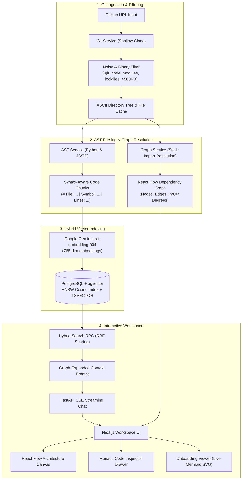

# 🧭 CodeAtlas — AI Codebase Explainer & Interactive Architecture Map

<div align="center">


<p align="center">
  <strong>Turn any public GitHub repository into a visual architecture map, syntax-aware vector index, streaming RAG chat, and developer onboarding guide.</strong>
</p>

</div>

---

## 🌟 Overview

**CodeAtlas** is an AI-powered developer onboarding and codebase exploration platform. Given any public GitHub repository URL, CodeAtlas clones the repo, filters out binaries and boilerplate, parses Abstract Syntax Trees (AST) to build an interactive dependency graph, indexes syntax-aware code chunks into a hybrid vector database (`pgvector` + Full-Text Search via Reciprocal Rank Fusion), and provides:

1. **An Interactive React Flow Architecture Map** with auto-layout (Left-to-Right or Top-to-Bottom) and degree centrality metrics.
2. **A Persistent RAG Chat** that answers codebase questions with real-time SSE streaming and clickable `[file_path:start_line-end_line]` citations.
3. **Cross-Component Synchronization**: Clicking any citation pans the architecture graph to the target module and slides open a Monaco Editor drawer with the exact lines highlighted.
4. **Automated Onboarding Documentation**: Generates a 6-section `ONBOARDING.md` with live dark-mode Mermaid.js sequence and data flow diagrams.

---

## 🏗️ Architecture & Data Flow



---

## ✨ Key Features

### ⚡ 1. Resilient Git Ingestion Engine
- Shallow clones (`--depth 1 --single-branch`) into temporary isolated storage.
- Intelligent URL normalizer supporting all GitHub URL formats (`https://`, `http://`, `github.com/...`, `/tree/main`, `?tab=readme`, `.git`).
- Strict filter excluding `.git`, `node_modules`, `venv`, lockfiles, binary/media files, and files exceeding 500 KB.
- Caches raw text files in PostgreSQL/in-memory for zero-disk, instant slide-over Monaco viewing.

### 🌳 2. Syntax-Aware AST Code Chunker
- Extracts top-level declarations (`function_definition`, `class_definition`, `method_definition`, `arrow_function`, `interface_declaration`).
- Prepends contextual headers to every chunk: `# File: {file_path} | Symbol: {symbol_name} | Lines: {start_line}-{end_line}`.
- Line-aware sliding-window fallback chunker (80 lines, 15 lines overlap) so citation line numbers remain 100% faithful to the source file.

### 🕸️ 3. Navigable React Flow Architecture Map
- Built with `@xyflow/react` and `dagre` auto-layout with instant **Left-to-Right (LR)** and **Top-to-Bottom (TB)** layout switching.
- Custom node design with directory badges, in/out degree counts, and muted pastel category accents:
  - 🔵 **UI Components**: Sky (`#38bdf8`)
  - 🟢 **Services & API Routes**: Emerald (`#34d399`)
  - 🟡 **Configs & Models**: Amber (`#fbbf24`)
  - 🟣 **Utilities & Core**: Purple (`#c084fc`)
- Interactive fuzzy search/filter bar and hover-based dependency dimming.

### 🔍 4. Hybrid Search Engine (Vector + Full-Text Search)
- Combines semantic vector similarity (`1 - (embedding <=> query_embedding)`) with PostgreSQL full-text search (`ts_rank(fts, query)`).
- Ranks results using **Reciprocal Rank Fusion (RRF)**:
  $$\text{RRF Score} = \frac{1}{60 + \text{rank}_{\text{vector}}} + \frac{1}{60 + \text{rank}_{\text{fts}}}$$
- **Graph Expansion**: Inspects the dependency graph to find files directly imported by the top 3 retrieved chunks, enriching the LLM context with neighboring module architecture.

### 💬 5. Streaming Q&A with Interactive Citation Linking
- Streams responses over **Server-Sent Events (SSE)** using FastAPI and Next.js ReadableStream.
- Transforms all inline `[file_path:start_line-end_line]` citations into interactive pill buttons.
- **Cross-Component Sync**: Clicking a citation button simultaneously:
  1. Smoothly pans and zooms the React Flow canvas to center the referenced file.
  2. Slides open the Monaco Editor drawer to the exact file, automatically scrolling to and highlighting lines `start_line` to `end_line`.

### 📖 6. Automated Developer Onboarding Docs
- Synthesizes a structured 6-section `ONBOARDING.md`:
  1. Executive Architecture Overview & Tech Stack
  2. System Data Flow Diagram (rendered into live SVG via Mermaid.js)
  3. Core Modules & Entry Points (with clickable line citations)
  4. Directory Structure Walkthrough
  5. Day-1 Local Setup & Run Guide
  6. "Where to Make Changes" Playbook
- One-click **"Copy MD"** and **"Download `ONBOARDING.md`"** export buttons.

---

## 🛠️ Tech Stack

| Domain | Technology | Purpose |
| :--- | :--- | :--- |
| **Frontend Framework** | [Next.js 15](https://nextjs.org/) (App Router, React 19) | Modern SSR/CSR hybrid application |
| **Styling & Theme** | [Tailwind CSS](https://tailwindcss.com/) | Low-contrast dark theme (`zinc-950` palette) |
| **Graph Visualization** | [@xyflow/react](https://reactflow.dev/) + [Dagre](https://github.com/dagrejs/dagre) | Directed dependency graph with automated layout |
| **Code Editor** | [@monaco-editor/react](https://github.com/suren-atoyan/monaco-react) | Read-only syntax viewer with line decorations |
| **Markdown & Diagrams** | [react-markdown](https://github.com/remarkjs/react-markdown) + [mermaid](https://mermaid.js.org/) | Live rendering of onboarding docs and diagrams |
| **Backend Framework** | [FastAPI](https://fastapi.tiangolo.com/) + [Uvicorn](https://www.uvicorn.org/) | High-performance Python async REST & SSE API |
| **AST Parsing** | Python `ast` + [tree-sitter](https://tree-sitter.github.io/) | Syntax-aware chunking and import resolution |
| **Git Operations** | [GitPython](https://gitpython.readthedocs.io/) | Isolated shallow repository cloning |
| **Vector DB** | [PostgreSQL](https://www.postgresql.org/) + [`pgvector`](https://github.com/pgvector/pgvector) | 768-dimensional vector cosine indexing & FTS |
| **AI Models** | [Google Gemini 3.8 Flash](https://ai.google.dev/) + `text-embedding-004` | Chat reasoning, doc synthesis, and vector embeddings |

---

## 📂 Repository Structure

```
codeAtlas/
├── backend/
│   ├── app/
│   │   ├── db/
│   │   │   └── supabase.py          # PostgreSQL/pgvector client + offline in-memory fallback
│   │   ├── models/
│   │   │   └── schemas.py           # Pydantic schemas, validation & URL normalizer
│   │   ├── services/
│   │   │   ├── ast_service.py       # Syntax-aware AST chunker (Python, JS/TS, fallback)
│   │   │   ├── chat_service.py      # SSE streaming Q&A engine with graph context
│   │   │   ├── embedding_service.py # Google GenAI text-embedding-004 batch embedder
│   │   │   ├── git_service.py       # Shallow clone, noise filtering, directory tree
│   │   │   ├── graph_service.py     # Static import resolver & React Flow graph builder
│   │   │   └── onboarding_service.py# High-signal ONBOARDING.md synthesizer
│   │   ├── config.py                # Pydantic BaseSettings configuration
│   │   └── main.py                  # FastAPI entry point & REST/SSE endpoints
│   ├── tests/                       # 22 automated unit and integration tests
│   ├── .env.example                 # Backend environment variable template
│   ├── requirements.txt             # Python dependencies
│   └── schema.sql                   # Database schema with vector extension & RRF function
├── frontend/
│   ├── src/
│   │   ├── app/
│   │   │   ├── repo/[id]/page.tsx   # Split-pane workspace (Map, Docs, Chat, Inspector)
│   │   │   ├── layout.tsx           # Global HTML layout & font definitions
│   │   │   └── page.tsx             # Landing hero, repository input bar & status tracker
│   │   ├── components/
│   │   │   ├── ArchitectureMap.tsx  # React Flow canvas with camera focus & minimap
│   │   │   ├── ChatPanel.tsx        # SSE chat panel with interactive citation badges
│   │   │   ├── CodeDrawer.tsx       # Slide-over Monaco viewer with line range highlights
│   │   │   ├── CustomNode.tsx       # Custom React Flow node with pastel category borders
│   │   │   ├── MermaidRenderer.tsx  # Client-side dark SVG diagram renderer
│   │   │   └── OnboardingView.tsx   # Onboarding doc viewer with export tools
│   │   ├── lib/
│   │   │   ├── api.ts               # Typed frontend API client
│   │   │   └── utils.ts             # Styling helpers and byte formatters
│   │   └── types/
│   │       └── index.ts             # Shared TypeScript interfaces
│   ├── .env.example                 # Frontend environment variable template
│   ├── package.json                 # Node dependencies and scripts
│   └── tailwind.config.ts           # Dark palette theme configurations
└── README.md
```

---

## ⚙️ Configuration & Environment Variables

### Backend (`backend/.env`)

Create `backend/.env` (or copy from `backend/.env.example`):

```env
# Server Configuration
PORT=8000
HOST=0.0.0.0
ENVIRONMENT=development
CORS_ORIGINS=["http://localhost:3000","http://127.0.0.1:3000"]

# File Ingestion Limits
MAX_FILE_SIZE_BYTES=512000
CLONE_TIMEOUT_SECONDS=60
# Optional: Path for cloned repositories (defaults to system temporary directory if empty)
STORAGE_BASE_DIR=

# PostgreSQL + pgvector (Supabase or self-hosted)
# Note: If omitted, CodeAtlas runs seamlessly in offline mode using an in-memory RRF vector store
SUPABASE_URL=https://your-project.supabase.co
SUPABASE_KEY=your-supabase-key

# Google Gemini API
# Note: If omitted, CodeAtlas uses deterministic 768-dim unit embeddings and mock RAG streaming
GEMINI_API_KEY=your-gemini-api-key
```

### Frontend (`frontend/.env.local`)

Create `frontend/.env.local`:

```env
# URL of the running FastAPI backend
NEXT_PUBLIC_API_URL=http://127.0.0.1:8000
```

---

## 🚀 Quickstart Guide

### Prerequisites
- **Python**: Version 3.11+ (virtual environment recommended)
- **Node.js**: Version 18+ and `npm`
- **Git**: Installed and available in your `PATH`

---

### Step 1: Set Up & Run the Backend

```bash
# 1. Navigate to backend directory
cd backend

# 2. Create and activate a virtual environment
# Windows (PowerShell):
python -m venv .venv
.\.venv\Scripts\Activate.ps1
# macOS/Linux:
# python3 -m venv .venv && source .venv/bin/activate

# 3. Install dependencies
pip install -r requirements.txt

# 4. Copy environment variables
cp .env.example .env

# 5. Start the FastAPI server (Port 8000)
# Note: On Windows with Python 3.14+, omit --reload for optimal proactor stability
python -m uvicorn app.main:app --host 127.0.0.1 --port 8000
```

> The API will be available at [http://127.0.0.1:8000](http://127.0.0.1:8000). Interactive Swagger docs: [http://127.0.0.1:8000/docs](http://127.0.0.1:8000/docs).

---

### Step 2: Set Up & Run the Frontend

Open a new terminal:

```bash
# 1. Navigate to frontend directory
cd frontend

# 2. Install dependencies
npm install

# 3. Create .env.local file
cp .env.example .env.local

# 4. Run the development server (Port 3000)
npm run dev
```

> Open [http://localhost:3000](http://localhost:3000) in your browser.

---

### Step 3: Run the Automated Test Suite

To verify all 26 unit and integration tests across ingestion, AST parsing, graph building, hybrid search, Gemini key settings, and onboarding synthesis:

```bash
# From the repository root:
# Windows (PowerShell):
$env:PYTHONPATH="backend"
.\backend\.venv\Scripts\python.exe -m pytest backend/tests -v

# macOS/Linux:
# PYTHONPATH=backend ./backend/.venv/bin/pytest backend/tests -v
```

---

## 📡 API Reference

| Method | Endpoint | Description |
| :--- | :--- | :--- |
| `GET` | `/api/health` | Health check, API version, and Gemini AI connectivity state |
| `GET` | `/api/settings/gemini` | Returns Gemini status, active models, and masked API key |
| `POST` | `/api/settings/gemini` | Validates API key via probe call, persists to `.env`, & hot-reloads services |
| `DELETE` | `/api/settings/gemini` | Clears API key and returns engine to deterministic offline mode |
| `POST` | `/api/repos/ingest` | Clones repo, parses AST, computes graph, embeds chunks, returns summary |
| `GET` | `/api/repos/{id}` | Retrieves repository metadata, status, and directory tree |
| `GET` | `/api/repos/{id}/graph` | Retrieves React Flow formatted dependency nodes and edges |
| `GET` | `/api/repos/{id}/chunks` | Retrieves paginated AST code chunks |
| `GET` | `/api/repos/{id}/file?path=...` | Fetches raw file content for Monaco code viewing |
| `POST` | `/api/repos/{id}/chat` | SSE streaming Q&A endpoint with graph-expanded context and citations |
| `GET` | `/api/repos/{id}/onboarding` | Fetches cached or newly synthesized `ONBOARDING.md` |
| `POST` | `/api/repos/{id}/onboarding` | Force-regenerates `ONBOARDING.md` using Gemini |

---

## 🗄️ Database Schema & Hybrid Search RPC

When connecting to Supabase or PostgreSQL with `pgvector`, execute `backend/schema.sql`. It provisions:

- **`repositories`**: Tracks cloned repos, status (`cloning`, `parsing`, `indexing`, `completed`, `failed`), ASCII tree, and graph JSON.
- **`code_chunks`**: Stores syntax-aware chunks, line ranges, symbols, `tsvector` generated column for English full-text search, and 768-dimension HNSW cosine vector index.
- **`onboarding_docs`**: Caches synthesized Markdown onboarding documentation.
- **`repository_files`**: Caches full source file texts for fast Monaco rendering without keeping cloned files on disk.
- **`match_code_chunks_hybrid(...)`**: Stored SQL procedure implementing **Reciprocal Rank Fusion (RRF)** to combine vector cosine distance and BM25/FTS ranks seamlessly.

---

## 📄 License

This project is licensed under the [MIT License](LICENSE).

